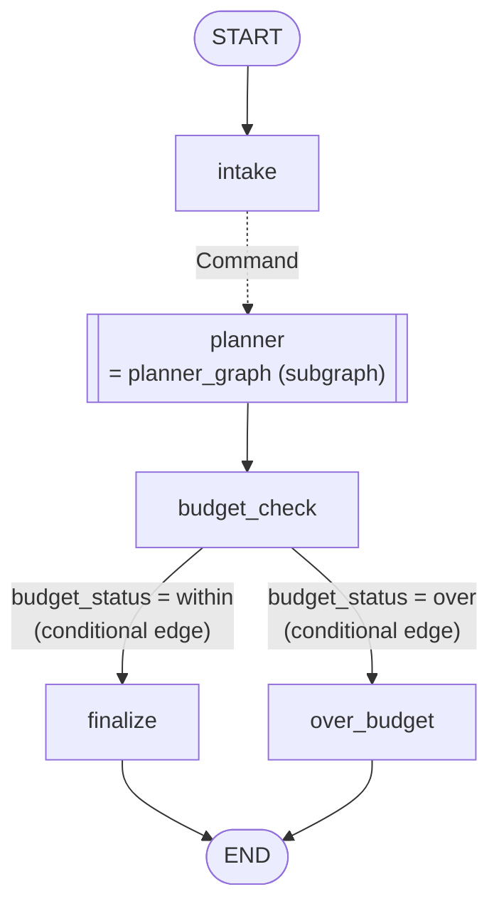
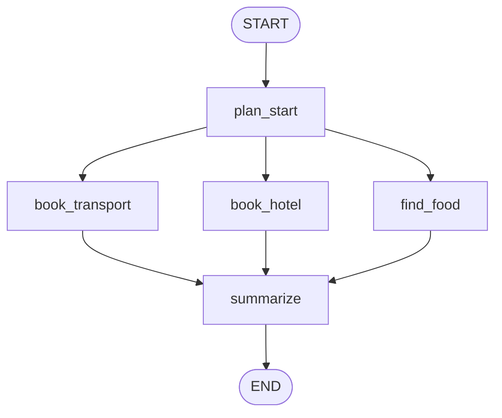

# LangGraph Individual Homework — Travel Planner Graph

This homework puts what you learned in examples 01–07, 09 and 10 (parallel nodes, reducers, conditional edges, Command, subgraphs) **into one graph**.
No LLM API is used. Every node only does arithmetic with a price table.

---

## 1. The Task

### Graph structure
**Main graph**


> **There is only one planner for both domestic and overseas trips.**
> The `planner` node is the compiled subgraph `planner_graph`. `intake` writes `trip_type`, and inside the subgraph `state["trip_type"]` picks the domestic or overseas prices from `PRICES`.
> (This is the recommended structure. Grading checks results only, so you may build it differently.)

**Inside `planner_graph`** (the `planner` node)

- Dotted lines are moves made by a `Command`; labeled solid lines are conditional edges.
- `book_transport`, `book_hotel` and `find_food` run in parallel.

### Input
```python
graph.invoke({"customer": "Kim", "destination": "Jeju", "days": 3, "budget": 500_000})
```

### State
The skeleton code defines `TravelState` (main graph) and `PlannerState` (planner subgraph).

**`TravelState` — main graph**
| Key | Type | Written by | Description |
|---|---|---|---|
| `customer` | `str` | input | Customer name |
| `destination` | `str` | input | Destination (e.g. `"Jeju"`, `"Paris"`) |
| `days` | `int` | input | Length of the trip in days |
| `budget` | `int` | input | Budget (won) |
| `trip_type` | `"domestic"` / `"overseas"` | `intake` | Domestic or overseas |
| `bookings` | `list[str]` | the 3 booking nodes | One line per booking. The three nodes write it **at the same time**, so every value must be kept |
| `total_cost` | `int` | the 3 booking nodes | Total travel cost. The three costs must be **added up** |
| `staff_status` | `dict[str, str]` | `intake`, the 3 booking nodes, `budget_check` | A "done" mark per node, like `{"intake": "done"}`. The dicts from several nodes must be **merged** |
| `ledger` | `list[LedgerItem]` | `intake`, the 3 booking nodes, `summarize` | (10 pts) Payment list including the booking fee. Its reducer is `merge_ledger` (section 3) |
| `budget_status` | `"within"` / `"over"` | `budget_check` | Budget result. `"within"` when `total_cost` is **less than or equal to** `budget` (the fee is not included) |
| `itinerary` | `str` | `finalize` / `over_budget` | The final message |

- You must attach a suitable reducer to `bookings`, `total_cost` and `staff_status` yourself (5 pts). Without one, you get an error when parallel nodes write the same key.

**`PlannerState` — planner subgraph**
| Key | Description |
|---|---|
| `trip_type`, `days` | Received from the parent graph. Used to pick prices and compute costs |
| `nights` | Number of nights (`days - 1`), computed by `plan_start`. It **exists only in the subgraph**, so it does not appear in the final result |
| `bookings`, `total_cost`, `staff_status`, `ledger` | Shared with the parent. Attach **the same** reducers as in `TravelState` |

- When the parent and the subgraph state have **a key with the same name**, values pass between them through that key automatically.

**Example final result** (Jeju, 3 days, budget 500,000, completed up to 10 pts)
```python
{
    "customer": "Kim", "destination": "Jeju", "days": 3, "budget": 500000,
    "trip_type": "domestic",
    "bookings": ["transport: round trip 120,000 won", "hotel: 2 nights 160,000 won", "food: 3 days 90,000 won"],
    "total_cost": 370000,
    "staff_status": {"intake": "done", "book_transport": "done", "book_hotel": "done",
                     "find_food": "done", "budget_check": "done"},
    "budget_status": "within",
    "ledger": [{"id": "fee", "label": "booking fee", "amount": 3000},
               {"id": "transport", "label": "transport", "amount": 120000},
               {"id": "hotel", "label": "hotel", "amount": 160000},
               {"id": "food", "label": "food", "amount": 90000}],
    "itinerary": "Kim / Jeju 3 days / 370,000 won (within budget)",
}
```
- Parallel nodes have no fixed order, so the order of items in `bookings`, `staff_status` and `ledger` may differ. Grading ignores the order.

### Price table (given in the code as `PRICES`)
| Item | Domestic | Overseas |
|---|---|---|
| Transport (round trip) | 120,000 | 450,000 |
| Hotel (per night) | 80,000 | 150,000 |
| Food (per day) | 30,000 | 60,000 |

- Domestic destinations are `DOMESTIC_CITIES = ["Jeju", "Busan", "Gangneung"]`, and only an **exact match** is domestic. Everything else is overseas.
- The number of nights is `days - 1`. A 1-day trip has 0 nights.
- The budget check uses `total_cost` (transport + hotel + food) only. The booking fee from the 10-pt part is **not added**.
- A `total_cost` **equal to the budget counts as within budget**.

### What each node does
| Node | Job |
|---|---|
| `intake` | Decides domestic or overseas, writes `trip_type`, and moves to `planner` with a `Command` |
| `plan_start` | `nights = days - 1` |
| `book_transport` / `book_hotel` / `find_food` | Run in parallel. Each adds one line to `bookings` and its cost to `total_cost` |
| `summarize` | (10 pts) Deletes 0-won items from `ledger` |
| `budget_check` | Decides within or over budget and writes `"within"` / `"over"` to `budget_status` |
| `route_budget` | The conditional edge function. It **only reads `budget_status`** and returns the next node's name: `"within"` → `"finalize"`, `"over"` → `"over_budget"` (no recalculation here) |
| `finalize` / `over_budget` | Build the final message `itinerary` with `format_itinerary(...)` |

- `intake`, `book_transport`, `book_hotel`, `find_food` and `budget_check` mark `"done"` in `staff_status` **under exactly these names**. Example: `{"book_hotel": "done"}`
  - Grading checks only these 5 keys. Extra marks from other nodes (`summarize`, `finalize`, ...) are fine.
- ⚠️ `intake` does not write to `bookings` or `total_cost`. You will find out why in the 10-pt part.
- The `bookings` string formats and `format_itinerary` usage are written in the TODO comments of the skeleton code.
- **Grading checks results only.** Node names and graph shape are up to you. But the names below are used by the grader, so do not rename them:
  - `graph`, `merge_ledger`, the State keys, the 5 `staff_status` keys above
  - `PRICES`, `DOMESTIC_CITIES`, `BOOKING_FEE`, `LEDGER_LABELS`, `format_itinerary`

### Public tests
| Input | Total cost | Result |
|---|---|---|
| Jeju, 3 days, budget 500,000 | 120,000 + 160,000 + 90,000 = 370,000 | within budget |
| Paris, 5 days, budget 1,000,000 | 450,000 + 600,000 + 300,000 = 1,350,000 | over by 350,000 |
| Busan, 2 days, budget 260,000 | 120,000 + 80,000 + 60,000 = 260,000 | within budget (boundary) |
| Gangneung, 5 days, budget 600,000 | 120,000 + 320,000 + 150,000 = 590,000 | within budget |
| Bangkok, 4 days, budget 1,000,000 | 450,000 + 450,000 + 240,000 = 1,140,000 | over by 140,000 |

`test_public.py` checks these inputs and some `merge_ledger` examples. It shows PASS / FAIL per stage and the score you have reached.
```bash
uv run python test_public.py
```

The real grading adds **many more hidden tests**. Hardcoding the public inputs will not pass.

---

## 2. Grading (step by step)

A stage counts only if every earlier stage passes.

| Points | Requirement |
|---|---|
| **3 pts** | Submitted, and `graph.invoke` runs to the end without error. The skeleton as given does not run. |
| **5 pts** | **Domestic trips done**: (recommended: run the 3 bookings in parallel in the planner subgraph) `total_cost`, `bookings` and `staff_status` (the 3 booking nodes) are correct for domestic trips |
| **8 pts** | **Whole flow done**: for every trip, domestic or overseas, within or over budget, `trip_type`, `total_cost`, `bookings`, `staff_status` (all 5), `budget_status` and `itinerary` are correct |
| **10 pts** | 8-pt requirements + **your own custom reducer `merge_ledger`** wired into the graph (section 3 below) |

---

## 3. 10-pt Challenge: the Custom Reducer `merge_ledger`

`ledger` is a **payment list** that includes the booking fee. Each item looks like this:
```python
{"id": "hotel", "label": "hotel", "amount": 160_000}
```

- Item `id`s and `label`s are given in the code as `LEDGER_LABELS` (`fee` → `"booking fee"`; the others are the same as their `id`). The amounts are `BOOKING_FEE` and the `cost` each node computes.
- `intake` registers the booking fee `[{"id": "fee", "label": LEDGER_LABELS["fee"], "amount": BOOKING_FEE}]`. Every node returns `ledger` as a **list**.
- The 3 parallel nodes register the `transport`, `hotel` and `food` items.
- `summarize` deletes items whose amount is 0 by sending `{"id": ..., "remove": True}`.
- It is separate from `total_cost` (the travel cost). The fee is never added to `total_cost`.

### `ledger` output of each node (Jeju, 3 days)
This is the `ledger` part of the dict each node returns. Return it together with the other keys (`bookings`, `total_cost`, `staff_status`, ...).

| Node | `ledger` it returns |
|---|---|
| `intake` | `[{"id": "fee", "label": "booking fee", "amount": 3000}]` (inside the `Command`'s `update`) |
| `book_transport` | `[{"id": "transport", "label": "transport", "amount": 120000}]` |
| `book_hotel` | `[{"id": "hotel", "label": "hotel", "amount": 160000}]` |
| `find_food` | `[{"id": "food", "label": "food", "amount": 90000}]` |
| `summarize` | No 0-won items, so nothing to delete (return no `ledger`, or `[]`) |

**Expected result**
```python
graph.invoke({"customer": "Kim", "destination": "Jeju", "days": 3, "budget": 500_000})["ledger"]
# [
#     {"id": "fee",       "label": "booking fee", "amount": 3000},
#     {"id": "transport", "label": "transport",   "amount": 120000},
#     {"id": "hotel",     "label": "hotel",       "amount": 160000},
#     {"id": "food",      "label": "food",        "amount": 90000},
# ]
```
- `fee` must appear **only once**.
- `transport`, `hotel` and `food` run in parallel, so their order may differ. Grading ignores the order.

### Deleting a 0-won item (Busan, 1 day)
A 1-day trip has 0 nights, so `book_hotel` registers `{"id": "hotel", "label": "hotel", "amount": 0}`.
`summarize` finds this item and returns a delete request.

| Node | `ledger` it returns |
|---|---|
| `book_hotel` | `[{"id": "hotel", "label": "hotel", "amount": 0}]` |
| `summarize` | `[{"id": "hotel", "remove": True}]` |

**Expected result**
```python
graph.invoke({"customer": "Kim", "destination": "Busan", "days": 1, "budget": 500_000})["ledger"]
# [
#     {"id": "fee",       "label": "booking fee", "amount": 3000},
#     {"id": "transport", "label": "transport",   "amount": 120000},
#     {"id": "food",      "label": "food",        "amount": 30000},
# ]
```

### Why do we need a custom reducer?
The skeleton's `merge_ledger` only concatenates the lists (same as `operator.add`). Keep it as it is, finish the 10-pt nodes and run the graph. How many times does `fee` appear? Think about what the subgraph hands back to the parent graph when it finishes.

### When is the reducer called, and with what?
Nodes never change the state directly; they only **return** `{"ledger": X}`. Each time, LangGraph calls `merge_ledger(left, right)` and stores the return value as the new `ledger`.

| Argument | What it is |
|---|---|
| `left` | The `ledger` list currently in the state |
| `right` | The value `X` the node returned for `ledger`: one item (dict) or a list of items. Normal items and delete requests (`{"id": ..., "remove": True}`) both arrive here |
| return value | The new `ledger`, stored in the state |

**What `merge_ledger` receives for Busan, 1 day** (items shown by `id` only)

| When | `left` | `right` | Should return |
|---|---|---|---|
| after `intake` | `[]` | `[fee]` | `[fee]` |
| subgraph starts (takes the parent's `ledger`) | `[]` (the subgraph's `ledger`) | `[fee]` | `[fee]` |
| after `book_transport` | `[fee]` | `[transport]` | `[fee, transport]` |
| after `book_hotel` | `[fee, transport]` | `[hotel (0 won)]` | `[fee, transport, hotel (0 won)]` |
| after `find_food` | `[fee, transport, hotel (0 won)]` | `[food]` | `[fee, transport, hotel (0 won), food]` |
| after `summarize` | `[fee, transport, hotel (0 won), food]` | `[{"id": "hotel", "remove": True}]` | `[fee, transport, food]` |
| subgraph ends, back in the parent | `[fee]` (the parent's `ledger`) | `[fee, transport, food]` (the subgraph's **whole** `ledger`) | `[fee, transport, food]` |

- The 3 parallel nodes may be called in a different order on each run.
- The last row is the key point. When the subgraph finishes, it hands its whole `ledger` back as `right`. What happens if you only concatenate?
- Returning a value for a key that has a reducer does not mean "**overwrite it**"; it means "**merge this in**". That is why returning a list without the 0-won item from `summarize` does not delete `hotel`. To delete it, send a `remove: True` request.

### `merge_ledger(left, right)` rules
1. Treat `left` or `right` as an empty list when it is `None`.
2. `right` can be one item (dict) or a list of items.
3. Apply the items in `right` **one at a time, in order**.
4. If the same `id` already exists, **replace** it with the new item but **keep its position**. Do not merge fields: the **whole** item is replaced. (Example: existing `{"id": "a", "label": "x", "amount": 1}` + incoming `{"id": "a", "amount": 2}` gives `{"id": "a", "amount": 2}`.)
5. An `id` not seen before is **appended** at the end.
6. `{"id": x, "remove": True}` **deletes** `x`. Ignore it if `x` does not exist. Only `remove` set to `True` is a delete request; any other item (no `remove`, or `remove: False`) is stored as a normal item exactly as received.
7. **Do not modify** the `left` and `right` you receive. Return a new list.
8. Raise `ValueError` when an item has no `id`.

### `merge_ledger` inputs and expected outputs
```python
a1 = {"id": "a", "amount": 1}
b2 = {"id": "b", "amount": 2}
```

| Rule | Input | Expected output |
|---|---|---|
| 1 | `merge_ledger(None, None)` | `[]` |
| 2 | `merge_ledger([], a1)` (a single dict) | `[a1]` |
| 4 | `merge_ledger([a1, b2], {"id": "a", "amount": 9})` | `[{"id": "a", "amount": 9}, b2]` (a keeps the first position) |
| 5 | `merge_ledger([a1], [b2])` | `[a1, b2]` |
| 6 | `merge_ledger([a1, b2], {"id": "a", "remove": True})` | `[b2]` |
| 6 | `merge_ledger([a1], {"id": "z", "remove": True})` | `[a1]` (missing id is ignored) |
| 3 | `merge_ledger([a1, b2], [{"id": "a", "remove": True}, {"id": "a", "amount": 5}])` | `[b2, {"id": "a", "amount": 5}]` (deleted, then added again → at the end) |
| 7 | `left = [a1]; merge_ledger(left, {"id": "a", "amount": 7})` | Returns `[{"id": "a", "amount": 7}]`; `left` is still `[a1]` |
| 8 | `merge_ledger([], {"amount": 1})` | `ValueError` |

`test_public.py` includes only some of these. Call the function yourself to check the rest.

### References (official LangGraph docs)
- Reducers: https://docs.langchain.com/oss/python/langgraph/graph-api#reducers
- Custom reducers: https://docs.langchain.com/oss/python/langgraph/graph-api#custom-reducers
- Messages and `add_messages` (a built-in reducer that overwrites by id, the same idea as this homework): https://docs.langchain.com/oss/python/langgraph/graph-api#working-with-messages-in-graph-state
